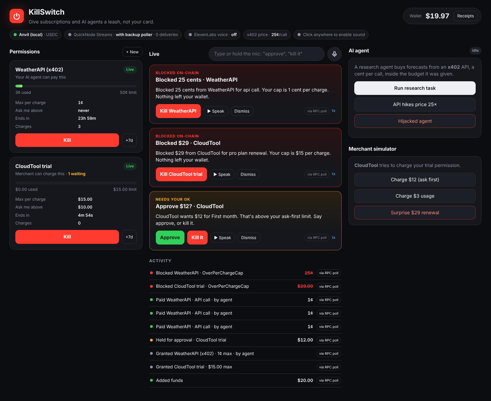

# KillSwitch

**A USDC spending firewall on Arc for people and their AI agents.**


Give a subscription, an API, or your own AI agent a *leash*, not your card.

> UBC 2026 Hackathon · **Main track:** Agentic Payments and AI · **Chain award:** Best use of Arc · **Bounties:** QuickNode Streams, ElevenLabs

---

## The problem

Everyone has been burned by a free trial that silently became a $29/month charge. Card networks and ERC-20 `approve()` share the same flaw: once a merchant has access, it's open-ended. You find out *after* the money is gone.

AI agents make this worse. An agent paying for APIs, MCP tools, and compute per request (x402) is a new spender that can be prompt-injected, can loop, or can get quoted a price that silently jumped 25×.

## What KillSwitch does

You (or your agent, within a ceiling you set) grant **mandates**: capped, expiring, revocable USDC permissions, one per merchant.

| | Card on file / ERC-20 `approve` | Privacy.com-style virtual card | **KillSwitch mandate** |
|---|---|---|---|
| Per-charge cap | ✗ | ✓ | ✓ enforced **on-chain** |
| Total cap + expiry | ✗ | partly | ✓ |
| "Ask me above $X" hold | ✗ | ✗ | ✓ funds stay in your vault until you approve |
| Works for **AI agents** paying x402 APIs | ✗ | ✗ | ✓ agent pushes, vault enforces |
| Blocked attempts are **provable** | ✗ | ✗ | ✓ every block is a `ChargeBlocked` event on Arc |
| Real-time voice alert + voice override | ✗ | ✗ | ✓ QuickNode Streams → ElevenLabs |

### Why it isn't a race condition

QuickNode Streams fires *after* an on-chain event. If merchants pulled from a plain allowance, an alert would always be too late. KillSwitch never relies on reacting in time:

1. **Enforcement is synchronous and on-chain.** `charge()` (merchant pull) and `pay()` (agent push) check the cap, total, expiry, kill state, and caller *before* any USDC moves.
2. **Violations don't revert. They're recorded.** A blocked charge emits `ChargeBlocked(reason)` and returns `false`. The attempt is now a permanent, auditable fact on Arc.
3. **Streams handles the human part.** Our Stream filter forwards only KillSwitch events; the server turns `ChargeBlocked` / `ChargeHeld` into an ElevenLabs voice alert with one-tap (or one-word) **Approve** / **Kill**.

---

## Demo in 60 seconds

| Action (dashboard button) | What happens on Arc | What you hear |
|---|---|---|
| CloudTool charges **$12** (ask-first is $10) | `ChargeHeld`: USDC stays in the vault | "CloudTool wants $12 for first month… Say approve, or kill it." → say **"approve"** |
| CloudTool **surprise $29 renewal** | `ChargeBlocked(OverPerChargeCap)`: $0 moves | "Blocked $29 from CloudTool for pro plan renewal. Your cap is $15 per charge." |
| Trial window passes, CloudTool tries again | `ChargeBlocked(Expired)` | "…Your trial window closed 2 minutes ago." |
| **Run research task** (AI agent) | 3 × `ChargeSettled` at 1¢ via x402 | (silent: inside the rules) |
| **API hikes price 25×** | nothing (the agent refuses before paying) | "Your agent refused to pay WeatherAPI. The price jumped from 1 cent to 25 cents…" |
| **Hijacked agent** (skips its own checks) | `ChargeBlocked(OverPerChargeCap)` | the vault still stops it |
| Say **"kill CloudTool"** | `MandateKilled` | "Killed CloudTool trial." |

---

## Architecture

```
            ┌──────────── you (dashboard / voice) ────────────┐
            │  Approve · Kill · "kill it" (ElevenLabs Scribe)  │
            └───────────────┬──────────────────────▲──────────┘
                            │ owner tx              │ SSE: alerts + mp3 (ElevenLabs TTS)
┌──────────┐  charge()  ┌───▼─────────────────┐     │
│ CloudTool│──────────▶│  KillSwitchVault     │     │
│ (SaaS)   │            │  on Arc Testnet      │  ┌──┴───────────────────────┐
└──────────┘            │  • caps / expiry     │  │ KillSwitch server (Node) │
┌──────────┐  pay()     │  • ask-first holds   │  │  /webhooks/quicknode     │
│ AI agent │──────────▶│  • kill switch       │  │   HMAC verify → decode   │
└────┬─────┘            │  emits ChargeSettled │  │   → alert → TTS          │
     │ 402 → pay → proof│  ChargeBlocked/Held  │  └──▲───────────────────────┘
┌────▼─────┐            └──────────┬───────────┘     │ webhook (signed)
│WeatherAPI│◀── verifies tx on Arc │                 │
│ (x402)   │                       ▼                 │
└──────────┘          QuickNode Streams (Arc Testnet, Block with Receipts,
                      filter = only KillSwitch vault events) ──────────────┘
```

| Path | What |
|---|---|
| `contracts/src/KillSwitchVault.sol` | The firewall: mandates, synchronous enforcement, holds, kill switch |
| `contracts/test/KillSwitchVault.t.sol` | 16 Foundry tests incl. a fuzz test that a merchant can never exceed caps |
| `contracts/script/Deploy.s.sol` | Deploys to Arc Testnet against Arc's USDC (`0x3600…0000`) |
| `quicknode/filter.js` | The Streams filter function |
| `server/src/agent.js` | The AI payment agent's decision loop (x402) |
| `server/src/events.js`, `streams.js` | Streams webhook (HMAC-verified) + event hub; backup RPC poller |
| `server/src/alerts.js`, `voice.js` | Alert wording, ElevenLabs TTS + Scribe STT, voice-command parser |
| `server/src/merchants.js` | Demo merchants: CloudTool (pull) and WeatherAPI (x402 server) |
| `server/public/` | Dashboard (dollars up front; tx hashes tucked under **Receipts**) |

---

## The agent's decision loop and safety limits

*(Agentic Payments track requirement)*

For every paid API request the agent runs:

1. **REQUEST** · call the API. On `402 Payment Required`, read the x402 quote (`payTo`, `maxAmountRequired`, `asset`).
2. **MATCH** · find a live, unexpired mandate for `payTo` with `agentCanPay = true`. None → stop and ask the human.
3. **JUDGE** (off-chain guardrails):
   - quote ≤ the mandate's per-charge cap
   - no **price spike**: quote ≤ `AGENT_PRICE_SPIKE_X` (2×) the first quote seen for that resource
   - spend stays inside the **task budget** (`AGENT_TASK_BUDGET_USD`, default $0.10)
4. **PREFLIGHT** · `vault.preview(mandateId, amount)` asks the chain whether this exact payment would settle, hold, or block.
5. **PAY** · `vault.pay()`. **The vault is the wall**: caps, totals, expiry, and kill state are re-checked on-chain, synchronously.
6. **PROVE** · retry with `X-PAYMENT` (base64 JSON containing the Arc tx hash). The API verifies the `ChargeSettled` event *on-chain* and rejects reused proofs.

**Defense in depth.** Steps 2–4 are the agent being well-behaved. Step 5 holds even when it isn't. The **Hijacked agent** button skips steps 2–4 the way a prompt-injected agent would, and the vault still blocks the overpayment.

**Hard limits enforced by the contract:**

| Limit | Where |
|---|---|
| Per-charge cap, total cap, max # of charges, expiry | every `charge()` / `pay()` |
| Only the named merchant can pull; only the agent can push, and only on `agentCanPay` mandates | `charge()` / `pay()` |
| **Agent ceiling**: mandates the *agent* grants itself can't exceed `agentMaxCapPerCharge` ($5 by default) | `createMandate()` |
| The agent can **kill** and **reject**, but only the human owner can **approve**, **extend**, or **withdraw** | role checks |
| "Ask above $X" holds keep USDC in the vault until the owner approves | `ChargeHeld` → `approvePending()` |
| Voice commands are parsed **deterministically** (no LLM guessing on money), and "kill" wins over "approve" if both are heard | `voice.js` |

---

## How we use Arc

*(Best use of Arc requirement)*

- **Contract:** `KillSwitchVault` on **Arc Testnet** (chain 5042002). **Address: [`0xAC5e2D8D4dE5673424557761f9ebf2b3283b48DC`](https://testnet.arcscan.app/address/0xAC5e2D8D4dE5673424557761f9ebf2b3283b48DC)**
- **USDC:** Arc's USDC ERC-20 interface `0x3600000000000000000000000000000000000000` (6 decimals) is the asset in every mandate.
- **USDC as gas:** every actor (owner, agent, merchant) pays gas in USDC. A merchant's *blocked* attempt costs it a predictable, dollar-denominated fee, and the user never needs a second token. `npm run setup` funds gas with plain native-USDC transfers.
- **Sub-second finality:** a held charge → voice alert → spoken "approve" → settled loop feels instant, and x402 per-request payments settle fast enough to sit inside an HTTP request/retry.
- **Tooling:** Foundry for build/test/deploy; viem in the app.

## How we use QuickNode Streams

*(QuickNode bounty requirement)*

| Setting | Value | Why |
|---|---|---|
| Network | **Arc Testnet** | where the vault lives |
| Dataset | **Block with Receipts** | we need logs *and* the tx hash for receipts / x402 proofs |
| Filter | [`quicknode/filter.js`](quicknode/filter.js) | keeps only logs whose `address` is our vault and whose `topic0` is a KillSwitch event (`ChargeBlocked`, `ChargeHeld`, `ChargeSettled`, `PendingResolved`, `MandateKilled`, `MandateCreated`, `MandateExtended`). Returns `null` for all other blocks, so nothing is delivered. Tags each match with `event` and `loud` (blocked/held = voice alert). |
| Destination | **Webhook** → `https://<PUBLIC_URL>/webhooks/quicknode` | the server verifies `X-QN-Signature` (HMAC-SHA256 of nonce + timestamp + body with the Stream's security token), handles gzip, decodes logs with the vault ABI, de-dupes by `txHash:logIndex` |
| Mode | `QN_STREAMS_PRIMARY=true` | alerts come **only** from Streams deliveries. The RPC poller is a dev-only fallback and is off. Every alert and feed row shows a **via QuickNode Streams** badge. |

Why Streams instead of polling: guaranteed in-order delivery and no polling loop. The filter also means our server is woken only when *your firewall* did something.

## How we use ElevenLabs

*(ElevenLabs bounty requirement)*

- **Text-to-Speech** (`eleven_flash_v2_5`, low latency): every `ChargeBlocked` / `ChargeHeld` / agent refusal becomes a spoken alert that says *who*, *how much*, and *why* ("…your trial window closed 2 minutes ago. Nothing left your wallet."). Confirmations are spoken too ("Killed CloudTool trial.").
- **Speech-to-Text** (Scribe `scribe_v1`): hold the mic and say "approve", "kill it", "block CloudTool", or "pause the agent". The transcript maps to a vault transaction, so voice is a real control surface, not a read-out.
- Accessibility: the whole approve/kill loop works hands-free and eyes-free.

---

## Run it

### Prerequisites
Node 20+, [Foundry](https://getfoundry.sh) (`curl -L https://foundry.paradigm.xyz | bash && foundryup`).

### A. Local in 2 minutes (no keys needed)
```bash
cd contracts && forge test        # 16 passing (forge-std is vendored in lib/)
cd ../server && npm install
anvil &                                     # local chain
npm run local                               # deploys MockUSDC + vault, writes .env.local
ENV_FILE=.env.local TRIAL_SECONDS=120 npm run setup
ENV_FILE=.env.local npm start               # http://localhost:8787
```
Add `ELEVENLABS_API_KEY` to `.env.local` to hear alerts (without it the browser's built-in voice is used as a labelled fallback).

### B. Arc Testnet (the real demo)
```bash
cd server && npm install
npm run keys > keys.txt      # 4 wallets; copy into .env (from .env.example)
# Fund OWNER with testnet USDC: https://faucet.circle.com → Arc Testnet

cd ../contracts
PRIVATE_KEY=<OWNER_PRIVATE_KEY> AGENT_ADDRESS=<agent address> ARC_RPC_URL=https://rpc.testnet.arc.network \
  forge script script/Deploy.s.sol --rpc-url arc_testnet --broadcast
# put the printed address in server/.env as VAULT_ADDRESS

cd ../server
TRIAL_SECONDS=180 npm run setup   # gas → agent & merchant, deposit $20, create the two demo mandates
npx ngrok http 8787               # set PUBLIC_URL to the https URL
npm start
```
Then create the Stream (QuickNode dashboard → Streams → Arc Testnet → Block with Receipts → paste `quicknode/filter.js` with your vault address → Webhook `PUBLIC_URL/webhooks/quicknode`), copy its security token into `QN_STREAM_SECRET`, set `QN_STREAMS_PRIMARY=true`, and restart.

### Tests
```bash
cd contracts && forge test   # 16 Solidity tests (incl. fuzz)
cd server && npm test        # 8 unit tests: voice intents, alert wording, Streams parsing + HMAC
```

---

## Honest scope notes
- **x402:** the WeatherAPI server returns real x402-shaped `402` responses (`accepts[]`, `payTo`, `maxAmountRequired`, `X-PAYMENT` / `X-PAYMENT-RESPONSE`). Settlement uses a custom scheme, `killswitch-vault`: the payment proof is the Arc tx hash of a vault `ChargeSettled`, verified on-chain. We didn't use the EIP-3009 `exact` scheme with a facilitator, because a vault contract can't produce an EOA transfer authorization.
- **Merchants are simulated** (CloudTool, WeatherAPI) with their own wallets and real on-chain transactions. Forecast data is synthetic.
- **"Invisible wallet":** the owner key lives server-side for the demo so there are no wallet pop-ups. In production this would be a Circle Wallets / passkey-backed wallet.
- One vault per user; a factory is the obvious next step.

## What's next
Circle Wallets with passkeys for the owner, a vault factory, EIP-3009 / Gateway support for x402 `exact`, merchant-side SDK (`preview()` before charging), and a browser extension that swaps "enter card" for "grant a mandate".

## License
MIT
